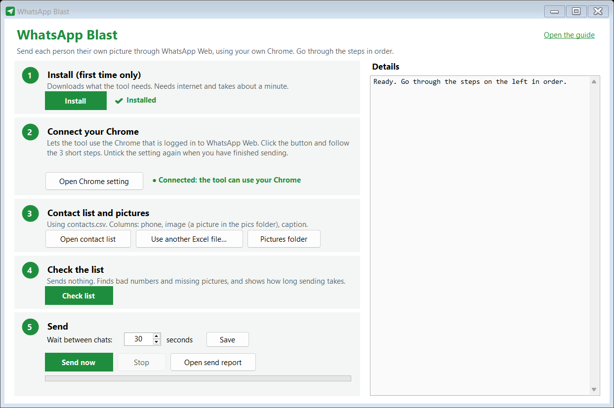

# WhatsApp Blast

Send each person on your list their own picture and caption through WhatsApp Web, with a pause between chats. It runs on your Windows PC and sends from the Chrome you are already logged in to.

- One picture per row, with an optional caption
- Checks the list before anything is sent
- Writes a report of every row: sent, failed, not on WhatsApp or skipped
- Safe to run again after a stop: pictures already sent to a number are skipped



**[Download the latest release](https://github.com/Riekie3/Whatsapp-Blast/releases/latest)**: take the `.zip`, unzip it, and double-click `WhatsApp Blast.exe`.

## What you need

- Windows
- [Google Chrome](https://www.google.com/chrome/), logged in to [WhatsApp Web](https://web.whatsapp.com)
- [Node.js](https://nodejs.org) 18 or newer

## The app (easiest)

Download `WhatsApp-Blast-<version>.zip` from the [latest release](https://github.com/Riekie3/Whatsapp-Blast/releases/latest) (or **Code > Download ZIP**), unzip it, open the folder and double-click **`WhatsApp Blast.exe`**. The app needs the other files in that folder, so do not download the `.exe` on its own for a first install. It shows the steps in order, each with a button:

1. **Install** (first time only): runs `1-INSTALL.bat` and closes it when done.
2. **Connect your Chrome**: copies the setting's address, opens a new Chrome tab and shows the 3 steps. The light turns green once Chrome allows the tool.
3. **Contact list and pictures**: **Open contact list** opens your list in Excel, or makes a new Excel list to fill in. **Use another Excel file…** makes any `.xlsx` with the right columns your list. **Pictures folder** opens `pics`.
4. **Check list**: runs `2-CHECK-LIST.bat` and shows how many rows are ready.
5. **Send**: set the wait between chats and save it, then **Send now** runs `3-SEND.bat`. It asks you to confirm first, shows progress, keeps the PC awake while sending, and can be stopped with **Stop**.

Everything the `.bat` files print appears under **Details**, so no black windows are left open.

Windows may warn that the app is from an unknown publisher, because it is not signed. Click **More info > Run anyway**. You can also build it yourself: double-click `build-app.bat` (uses the C# compiler that comes with Windows).

The app has to stay in the WhatsApp Blast folder, next to `send.js`.

## First-time setup without the app

1. Download this repository (**Code > Download ZIP**, then unzip it) or clone it.
2. Double-click `1-INSTALL.bat`. It needs internet and takes about a minute.
3. Copy `contacts-template.csv` and rename the copy to `contacts.csv`.
4. In the Chrome that is logged in to WhatsApp Web, open `chrome://inspect/#remote-debugging` and tick **Allow remote debugging for this browser instance**. Chrome does not let programs open this page for you, so type or paste the address yourself.

> **Security:** while that box is ticked, programs on your PC can ask to control that Chrome, including sites you are signed in to. Untick it when you have finished sending.

## Your contact list

Put your pictures in the `pics` folder, then fill in `contacts.csv`. Row 1 must be these headers:

| Column | What to put |
|---|---|
| `phone` | Number with country code, e.g. `60123456789`. Dashes and spaces are fine. Malaysian numbers starting with `0` or `1` get the country code added. |
| `image` | The picture's file name in the `pics` folder, e.g. `ali.jpg` |
| `caption` | Optional text sent with the picture, e.g. `"Dear, Ali"` (use quotes if it contains a comma) |

You can also use an Excel file named `contacts.xlsx` in the main folder. If it exists, it is used instead of `contacts.csv`. Excel is the safer choice: when Excel saves a CSV file it can turn long phone numbers into `6.01E+10`. The app's **Open contact list** button offers to turn `contacts.csv` into `contacts.xlsx` (with the phone numbers stored as text), and keeps the CSV as `contacts-before-excel.csv`. Without the app: `node send.js --to-excel`, or `node send.js --new-excel` for a new list.

The numbers and names in the template are dummies. Replace them with your own.

CSV files are read as UTF-8, so captions in Chinese or with accents are sent correctly.

## Sending

1. Double-click `2-CHECK-LIST.bat`. It sends nothing. It lists bad numbers and missing pictures, and shows how long the blast will take.
2. Close any WhatsApp Web tab you have open.
3. Click your logged-in Chrome window once, so the right Chrome profile is used.
4. Double-click `3-SEND.bat` and click **Allow** if Chrome asks.
5. A new WhatsApp tab opens and sending starts. Leave that tab and the black window open until it says **Finished**.

The tool then closes its own tab. The rest of Chrome stays open.

**Test first:** send one or two rows to your own number before sending to everyone.

## Results

`sent-log.csv` is created with these columns: `time, name, phone, status, detail`. The name is the picture's file name.

| Status | Meaning |
|---|---|
| `SENT` | The picture was sent |
| `NOT_ON_WHATSAPP` | The number has no WhatsApp account |
| `FAILED` | Sending failed; see `detail`. It is tried again on the next run |
| `SKIPPED` | Bad number or missing picture |

Running `3-SEND.bat` again skips any picture already `SENT` to that number. One number can receive different pictures: give each its own row. To send the same list again from the start, delete or rename `sent-log.csv`.

## Settings

The wait between chats can be changed in the app (step 5, **Save**). Or right-click `send.js`, open it with Notepad, and edit the lines under **Settings**:

```js
const GAP_SECONDS = 30; // wait between each chat
const USE_MY_CHROME = true; // true = the Chrome you already use; false = a separate Chrome window
```

- `GAP_SECONDS` is the wait between chats, in seconds. A shorter wait raises the risk of a ban.
- `USE_MY_CHROME = false` opens a separate Chrome window with a QR login instead. **This does not work at present** (checked 27 Nov 2026): WhatsApp changed its login page and the underlying library never gets past it ([whatsapp-web.js issue 201988](https://github.com/wwebjs/whatsapp-web.js/issues/201988)).

## Files

| File | Purpose |
|---|---|
| `WhatsApp Blast.exe` | The app with a button for each step |
| `build-app.bat`, `app/` | Source of the app and the script that builds it |
| `1-INSTALL.bat` | Installs the packages (first time only) |
| `2-CHECK-LIST.bat` | Checks the list without sending |
| `3-SEND.bat` | Sends the messages |
| `send.js` | The program |
| `contacts-template.csv` | Dummy contact list to copy |
| `pics/` | Your pictures (two samples included) |
| `README.txt` | Short offline guide |

## Privacy

`.gitignore` only allows the program files, the app, the template, the README screenshot and the two sample pictures. Your contact lists, reports, pictures and Chrome data are not committed. Do not force-add them.

## Use responsibly

This tool uses [whatsapp-web.js](https://github.com/wwebjs/whatsapp-web.js), an unofficial library. It is not made or endorsed by WhatsApp, and WhatsApp can ban numbers that use it.

- Only message people who know you and expect to hear from you.
- With a new number, start with 30-50 messages a day and increase slowly.
- Put the person's name in each caption so messages are not identical.

## License

Free and open source under the [MIT License](LICENSE). The libraries it uses, including whatsapp-web.js (Apache-2.0), keep their own licences.
